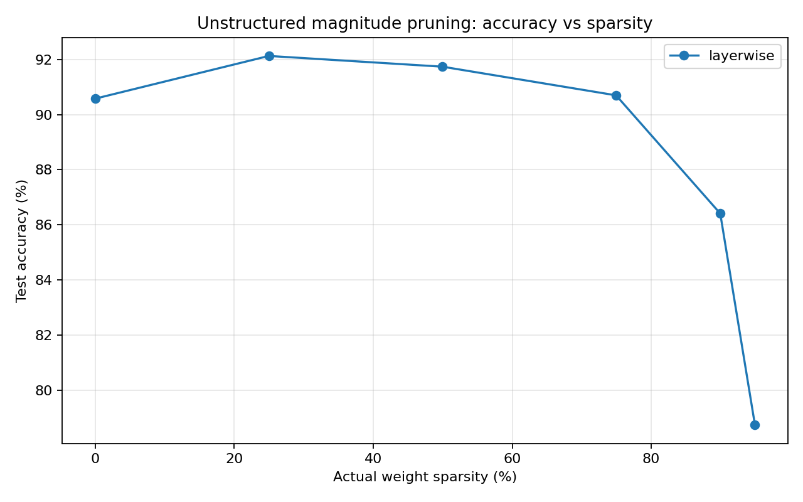
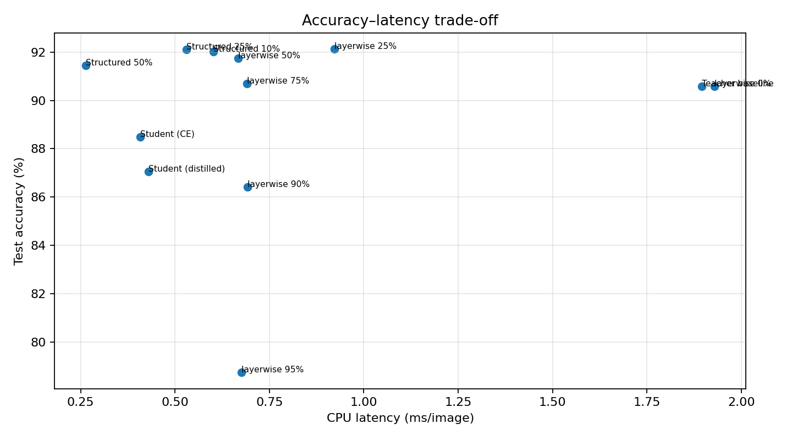

# Lab 07 — Model Compression: Pruning and Knowledge Distillation

## 1. Abstract

This laboratory investigates neural network compression techniques and their impact on predictive accuracy, model size, inference latency, and computational efficiency. The experiments use Fashion-MNIST and compare an oversized convolutional neural network (Teacher), pruning strategies, and a compact Student network trained with standard cross-entropy and knowledge distillation.

The results demonstrate that compression is not determined by parameter count alone. Unstructured pruning reduces the number of nonzero weights but does not necessarily accelerate dense inference. Structured pruning physically reduces network dimensions and provides more substantial latency improvements. Knowledge distillation was also evaluated, although it did not outperform standard cross-entropy training in this experiment.

## 2. Experimental Setup

### 2.1 Dataset

Fashion-MNIST was used as the image classification benchmark. It contains grayscale images of clothing items with a resolution of 28 × 28 pixels. The same dataset split and preprocessing pipeline were used across the experiments to make the comparisons consistent.

### 2.2 Models and hardware

| Component | Configuration |
|---|---|
| Dataset | Fashion-MNIST |
| Image format | Grayscale, 28 × 28 |
| Training device | NVIDIA CUDA GPU (Kaggle Tesla T4) |
| Inference benchmark | CPU, 1 thread |
| Teacher parameters | 866,282 |
| Student parameters | 94,042 |
| Student compression by parameters | 89.14% fewer parameters |
| Distillation temperature | 4.0 |
| Distillation alpha | 0.5 |

The Teacher is the larger reference model. The Student is a compact architecture designed to reduce computational and storage requirements.

### 2.3 Evaluation methodology

Model quality was evaluated using test accuracy. Inference performance was measured on CPU with one thread, a warm-up of five batches, and 30 timed repetitions. The benchmark used batches of up to 128 images.

Latency is reported in milliseconds per image. Checkpoint sizes refer to the saved model representations and are not equivalent to the number of parameters alone.

## 3. Baseline Model

The uncompressed Teacher provides the reference point for the compression experiments.

| Metric | Teacher |
|---|---:|
| Test accuracy | 90.58% |
| Parameters | 866,282 |
| CPU latency | 1.8946 ms/image |
| Dense checkpoint | 3,388.4 KiB |
| Sparse-format representation | 4,354.3 KiB |

The baseline demonstrates that the larger model achieves strong classification accuracy, but its inference latency and storage requirements leave room for optimization.

An important observation is that the sparse-format representation is larger than the dense checkpoint in this case. Sparse storage introduces additional indexing and metadata overhead. Therefore, reducing the number of nonzero weights does not automatically reduce the size of every possible model representation.

## 4. Magnitude Pruning

### 4.1 Method

Magnitude pruning removes weights with the smallest absolute values. The objective is to reduce the number of active parameters while preserving as much predictive performance as possible.

Two unstructured approaches are implemented:

- **Global pruning:** selects weights with the smallest absolute magnitudes across all prunable layers.
- **Layer-wise pruning:** applies the target sparsity independently to each prunable layer.

After pruning, the remaining weights are fine-tuned for three epochs. Pruning masks are re-applied after optimizer updates to prevent removed weights from becoming nonzero again.

Unstructured pruning preserves the original tensor dimensions. Consequently, the parameter count and dense checkpoint dimensions remain essentially unchanged even when many weights are zero.

### 4.2 Layer-wise pruning results

The following table reports the measured test accuracy and CPU latency.

| Target sparsity | Actual sparsity | Test accuracy | Nonzero weights | CPU latency (ms/image) |
|---:|---:|---:|---:|---:|
| 0% | 0.00% | 90.58% | 866,282 | 1.9292 |
| 25% | 24.98% | 92.13% | 649,890 | 0.9215 |
| 50% | 49.96% | 91.74% | 433,498 | 0.6670 |
| 75% | 74.94% | 90.70% | 217,106 | 0.6907 |
| 90% | 89.93% | 86.41% | 87,271 | 0.6913 |
| 95% | 94.92% | 78.73% | 43,993 | 0.6754 |

### 4.3 Analysis

The best measured layer-wise result was obtained at 25% target sparsity, reaching 92.13% test accuracy. This is 1.55 percentage points higher than the Teacher baseline.

At 50% and 75% sparsity, accuracy remained relatively close to the baseline. However, performance declined more noticeably at 90% and 95% sparsity. This indicates that removing too many weights eventually damages the model's ability to represent useful features.

The measured CPU latency decreased substantially compared with the baseline. However, the latency values should be interpreted as hardware- and runtime-specific measurements rather than a universal consequence of sparsity.

**Global pruning status:** The global pruning implementation and training procedure are included in the project. A complete, separately verified global-pruning test-results table was not produced in the final Kaggle run, so global pruning is not included in the quantitative comparison above.

## 5. Structured Pruning

### 5.1 Method

Structured pruning removes entire output filters from convolutional layers. Filters are selected according to their L2 norm. The network is then rebuilt with smaller dense layers and fine-tuned.

Unlike unstructured pruning, structured pruning physically changes the network dimensions. This reduces the number of parameters and the amount of dense computation required during inference.

### 5.2 Results

| Target filter pruning | Test accuracy | Parameters | CPU latency (ms/image) | Dense checkpoint (KiB) |
|---:|---:|---:|---:|---:|
| 10% | 92.03% | 770,618 | 0.6012 | 3,014.4 |
| 25% | 92.10% | 637,298 | 0.5299 | 2,493.7 |
| 50% | 91.45% | 417,530 | 0.2642 | 1,635.3 |

### 5.3 Analysis

Structured pruning achieved strong results across all three tested pruning levels.

At 25% filter pruning, the model achieved 92.10% test accuracy with 637,298 parameters. This represents approximately 26.43% fewer parameters than the Teacher while maintaining accuracy above the baseline.

At 50% filter pruning, the parameter count decreased to 417,530, approximately 51.81% fewer than the Teacher. Test accuracy remained at 91.45%, while CPU latency fell to 0.2642 ms/image.

These measurements illustrate why structured pruning can be particularly useful for practical deployment: the resulting model has smaller dense tensors rather than merely containing more zero-valued weights.

## 6. Knowledge Distillation

### 6.1 Method

Knowledge distillation transfers information from a larger Teacher model to a smaller Student model. Instead of learning exclusively from the ground-truth labels, the Student also learns from the Teacher's softened output probabilities.

The distillation objective is:

`Loss = alpha * CE(student, labels) + (1 - alpha) * T^2 * KL(student/T || teacher/T)`

The experiment used:

- Temperature: T = 4.0
- Alpha: 0.5
- Student size: 94,042 parameters

Two Student models were compared: one trained using standard cross-entropy (CE), and another trained using the combined distillation objective (KD).

### 6.2 Results

| Model | Test accuracy | Parameters | CPU latency (ms/image) | Dense checkpoint (KiB) |
|---|---:|---:|---:|---:|
| Student — CE | 88.49% | 94,042 | 0.4082 | 371.7 |
| Student — KD | 87.06% | 94,042 | 0.4295 | 371.9 |

### 6.3 Analysis

The standard Student achieved 88.49% test accuracy, while the distilled Student achieved 87.06%.

In this experiment, knowledge distillation did not improve test accuracy. The distilled model was 1.43 percentage points below the CE-trained Student and had slightly higher measured latency.

Both Student models are substantially smaller than the Teacher: they use approximately 89.14% fewer parameters. Their CPU latency is also considerably lower.

The result demonstrates that knowledge distillation is not guaranteed to improve every compact model. Its effectiveness depends on factors such as model capacity, training configuration, optimization, and the quality of the Teacher's predictions.

## 7. Efficiency Analysis

The experiments can be interpreted using four efficiency pillars.

### 7.1 Data efficiency

All approaches use the same Fashion-MNIST dataset and preprocessing pipeline. This keeps the data conditions consistent and makes it easier to attribute differences to model architecture and training methods.

### 7.2 Model efficiency

The Teacher contains 866,282 parameters, while the Student contains 94,042. Structured pruning also reduces the Teacher's parameter count by physically removing filters.

Unstructured pruning reduces the number of nonzero weights but does not change the original dense tensor dimensions. Therefore, dense checkpoint size may remain nearly constant.

### 7.3 Compute efficiency

CPU inference measurements show that smaller dense architectures can provide substantial latency improvements.

The 50% structured-pruning model achieved 0.2642 ms/image compared with 1.8946 ms/image for the Teacher. This is approximately a 7.2× reduction in measured latency.

Sparse weight count alone is not sufficient to predict inference speed. Standard dense kernels may still process the original tensor dimensions, even when many weights are zero.

### 7.4 Energy efficiency

The project estimates energy per image using measured latency and a nominal CPU power setting of 15 W:

`Estimated energy = inference latency × nominal CPU power`

This value is an energy proxy, not a direct measurement from a hardware power meter. It is useful for relative discussion under the same assumptions but should not be interpreted as an exact measurement of real energy consumption.

## 8. Overall Comparison

The main findings can be summarized as follows:

| Approach | Main advantage | Main limitation |
|---|---|---|
| Global magnitude pruning | Removes small weights across layers | No complete verified test-results table in the final run |
| Layer-wise pruning | Controls sparsity independently per layer | Dense tensor dimensions remain unchanged |
| Structured pruning | Reduces parameters and dense computation | Requires rebuilding the network |
| Knowledge distillation | Trains a compact model using Teacher outputs | Did not improve Student accuracy in this experiment |

The experiments show that there is no single compression technique that optimizes every metric simultaneously.

Layer-wise pruning at 25% provided the highest measured test accuracy among the listed pruning configurations. Structured pruning at 50% provided the lowest measured CPU latency among the compared models. The CE-trained Student offered a compact alternative with fewer than 100,000 parameters.

## 9. Limitations

Several limitations should be considered when interpreting the results:

1. Global pruning does not have a complete verified test-results table in the final Kaggle experiment.
2. Latency measurements depend on the CPU, software environment, thread configuration, and benchmark procedure.
3. The energy values are estimates based on nominal power, not direct hardware measurements.
4. The Student trained with knowledge distillation did not outperform the standard CE-trained Student in this configuration.
5. Sparse-format checkpoint size depends on the storage representation and metadata overhead.

These limitations do not invalidate the experiments, but they define the scope of the conclusions.

## 10. Conclusion

This laboratory compared unstructured magnitude pruning, structured filter pruning, and knowledge distillation as neural network compression techniques.

The results demonstrate that moderate pruning can preserve or even improve test accuracy after fine-tuning. Layer-wise pruning at 25% achieved 92.13% test accuracy, while structured pruning at 25% achieved 92.10%.

Structured pruning provided the clearest reduction in dense model size and inference latency. At 50% filter pruning, the model retained 91.45% test accuracy with approximately half the Teacher's parameters and substantially lower CPU latency.

The compact Student models demonstrated that a network with approximately 89% fewer parameters can still achieve 87–88% test accuracy. However, knowledge distillation did not improve the result over standard cross-entropy training in the tested configuration.

Overall, model compression requires balancing accuracy, parameter count, storage, and inference performance. The most appropriate method depends on the deployment constraints and the hardware on which the model will run.

## 11. Reproducibility

The project contains the implementation, configuration, result tables, plots, and generated measurements.

Main project files:
- `src/models.py` — model architectures.
- `src/engine.py` — training, evaluation, and benchmarking utilities.
- `src/pruning.py` — pruning methods.
- `src/run_all.py` — standard experiment pipeline.
- `src/run_kaggle.py` — Kaggle experiment pipeline.
- `configs/config.yaml` — experiment configuration.
- `results/` — CSV measurements, plots, and generated report.

The standard pipeline can be started from the repository root with:

`python lab07\run_all.py`

The Kaggle pipeline can be executed from the Lab 7 directory with:

`python src/run_kaggle.py --config configs/config.yaml`

All reported accuracy values are test-set measurements. Hardware-specific latency and energy-proxy values should not be generalized to other systems.
